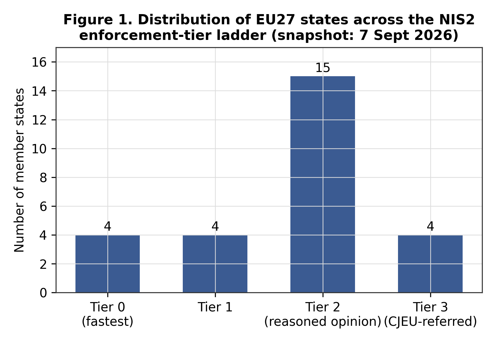
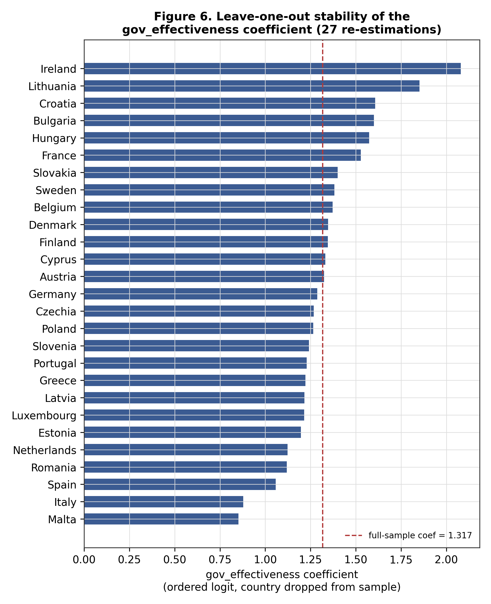

# Institutional drivers of NIS2 implementation across the EU27

Undergraduate final paper (Bocconi University). A small-N empirical study of why EU member states moved through NIS2 implementation and enforcement at different speeds, built on an original, hand-verified dataset covering all 27 member states.

## Research question

Does generic administrative capacity, or domain-specific cyber-governance capacity, explain why some member states transposed the NIS2 Directive faster and faced less enforcement action than others?

## Data

All 27 EU member states, no missing observations, with a collection cutoff of **7 September 2026**. Everything is in [`data/`](data/):

- **`EU27_NIS2_dataset.xlsx`**: the full dataset (sheet `Data`) plus a `Codebook` sheet with sources and coding rules.
- **`data/processed/`**: the CSV versions used by the scripts, and a markdown [codebook](data/processed/codebook.md).

Main variables:

| Variable | What it measures | Source |
|---|---|---|
| `enforcement_tier` | Position on the Commission's NIS2 infringement ladder (0 = transposed on time or close to it, 1 = formal notice, 2 = reasoned opinion, 3 = referred to the CJEU) | European Commission infringement record |
| `delay_days`, `time_since_directive_days`, `censored` | Time to national transposition (hand-verified dates from national gazettes and legal sources; 22 observed, 5 right-censored) | National gazettes, legal trackers |
| `gov_effectiveness` | World Bank Government Effectiveness (generic administrative capacity), 2024 | World Bank WGI API |
| `dedicated_cyber_agency` | 1 if the NIS2 single point of contact is a specialised, cyber-dedicated body (13 of 27) | Commission's per-country NIS2 pages, coded for this study |
| `cyber_gov_maturity` | Domain-specific cyber-governance index (0–2): strategy recency + dedicated agency | ENISA, Commission pages |
| `gdp_per_capita_ppp`, `population` | Controls | World Bank, Eurostat |

The outcome distribution: 4 states at tier 0, 4 at tier 1, 15 at tier 2 and 4 at tier 3 (Ireland, France, the Netherlands and Spain). Among the 22 states with an observed transposition date, the median delay past the 17 October 2024 deadline is 223 days (range −245 to +565).



## Method

- **Primary model:** ordered logit of `enforcement_tier` on `gov_effectiveness`, `cyber_gov_maturity` and log GDP per capita.
- **Robustness:** ordered probit; `dedicated_cyber_agency` alone instead of the index; adding log population; and 27 leave-one-out re-estimations.
- **Independent check:** a Cox proportional-hazards model of time to transposition, with the five untransposed states treated as right-censored.
- Two outcome measures and two model classes are used on purpose: if the same pattern appears in both, it is less likely to be an artifact of one specification.

## Results

| Model | `gov_effectiveness` | `cyber_gov_maturity` |
|---|---|---|
| Ordered logit (coefficient, p) | **+1.32** (p = 0.26) | −0.16 (p = 0.75) |
| Cox PH (hazard ratio, p) | **0.61** (p = 0.47) | **1.59** (p = 0.12) |

(In the ordered logit a positive coefficient means a *worse* enforcement tier; in the Cox model a hazard ratio above 1 means *faster* transposition.)

1. **Generic administrative capacity does not predict faster implementation, and the point estimate points the other way.** Higher Government Effectiveness goes with worse enforcement tiers and slower transposition. The sign is the same in the ordered logit, the ordered probit and the Cox model, and it holds in all 27 leave-one-out re-estimations (the coefficient ranges from 0.85 to 2.08).
2. **Domain-specific capacity points the expected way.** Having a dedicated cyber agency and a higher `cyber_gov_maturity` both go with better outcomes in the ordered logit and the Cox model. The hazard ratio of 1.59 is the estimate closest to conventional significance (p ≈ 0.12).



**No coefficient reaches conventional statistical significance.** With N = 27 that was expected, and the results should be read as consistent directions across different tests, not as confirmed effects. Government Effectiveness and log GDP per capita are also strongly correlated (about 0.75), which makes their separate estimates imprecise.

## Limitations

- **N = 27:** the confidence intervals are wide, and single countries can move estimates (hence the leave-one-out checks).
- **Association, not causation:** there is no causal identification.
- **The outcome measures legal compliance, not cybersecurity quality.** The enforcement tier is a position on the Commission's infringement ladder, and the timing of Commission action involves some discretion.
- **Two measures can diverge.** For Latvia, the transposing regulation (in force 2 July 2025) postdates the last public infringement update (7 May 2025), so the two outcome variables may be measuring different things for that case.
- **`dedicated_cyber_agency` involves coding judgment.** Six borderline cases (Estonia, Finland, Romania, Croatia, Slovakia, Sweden) could be coded the other way; see the [codebook](data/processed/codebook.md).

## Repo structure

```
├── README.md
├── requirements.txt
├── code/
│   ├── build_dataset.py            # builds eu27_nis2_dataset_v2.csv
│   ├── build_delay_days.py         # builds delay_days_partial.csv, with per-country source notes
│   ├── analysis.py                 # ordered logit, probit, robustness, leave-one-out
│   ├── survival_analysis.py        # Cox proportional hazards
│   └── make_forest_plots.py        # redraws Figures 4 and 5 from the saved tables
├── data/
│   ├── EU27_NIS2_dataset.xlsx
│   └── processed/                  # CSVs + codebook.md
├── tables/                         # regression and descriptive tables (CSV)
└── figures/                        # Figures 1–6
```

## Reproduce

```bash
pip install -r requirements.txt
python code/analysis.py              # ordered logit + robustness + leave-one-out
python code/survival_analysis.py     # Cox PH
python code/make_forest_plots.py     # Figures 4 and 5
```

Run all commands from the repository root. `build_dataset.py` and `build_delay_days.py` rebuild the CSVs from the hand-collected values stored in the scripts.

## Author

Karan Baylav · [LinkedIn](https://www.linkedin.com/in/karan-baylav)
