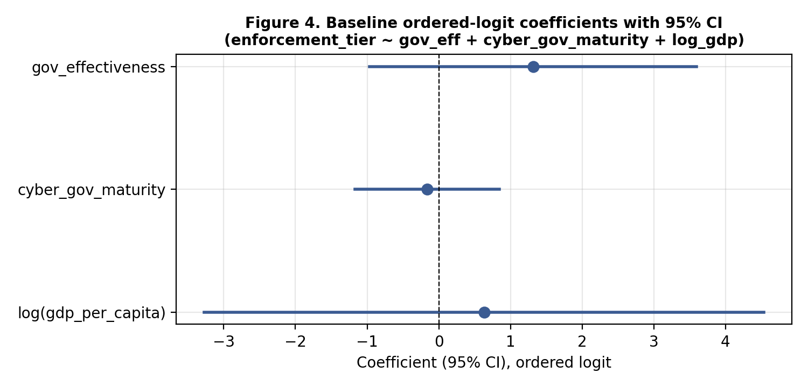
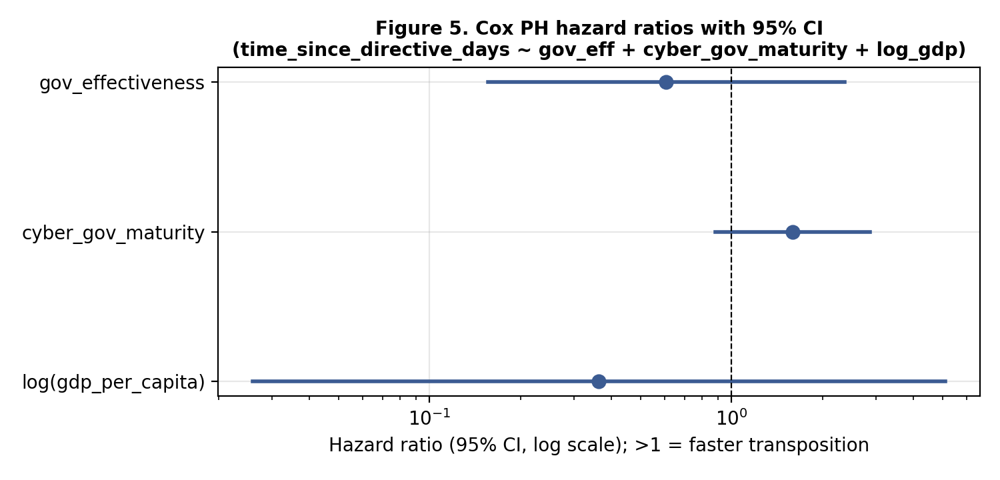

# Why did EU states implement NIS2 at different speeds?

A small-N empirical study of institutional capacity and compliance with the EU's NIS2 cybersecurity directive, built on an original, hand-verified dataset covering all 27 member states. Undergraduate final paper, Bocconi University (2026).

**In short**

- Generic administrative capacity (World Bank Government Effectiveness) does **not** predict faster NIS2 implementation. The estimated sign is reversed, in every specification I tried.
- Domain-specific capacity (a dedicated cybersecurity agency and a current national strategy) points the expected way, and its Cox hazard ratio of 1.59 (p = 0.12) is the estimate closest to conventional significance.
- **No coefficient is statistically significant.** With 27 countries that was expected. The paper's claim is a consistent direction across different tests, not a confirmed effect.

---

## Research question

The NIS2 Directive had to be in national law by **17 October 2024**. By September 2026 some states had transposed it on time, and four had been referred to the Court of Justice of the EU. Does generic administrative capacity, or domain-specific cyber-governance capacity, explain why?

Two hypotheses were written down before the results were examined:

- **H1 (generic capacity):** higher Government Effectiveness goes with faster, less escalated compliance.
- **H2 (domain-specific capacity):** pre-existing cyber-governance capacity (a dedicated cyber agency and a recent national strategy) matters independently of generic capacity.

## Data

All 27 EU member states, no missing values, collected up to **7 September 2026**. Everything is in [`data/`](data/):

- [`EU27_NIS2_dataset.xlsx`](data/EU27_NIS2_dataset.xlsx): the full dataset (sheet `Data`) plus a `Codebook` sheet with sources and coding rules.
- [`data/processed/`](data/processed/): the CSV versions used by the scripts, and a [codebook](data/processed/codebook.md).

| Variable | What it measures | Source |
|---|---|---|
| `enforcement_tier` | Position on the Commission's NIS2 infringement ladder (0 = on time or close, 1 = formal notice, 2 = reasoned opinion, 3 = referred to the CJEU) | European Commission infringement record |
| `delay_days`, `time_since_directive_days`, `censored` | Time to national transposition, from hand-verified dates (22 observed, 5 right-censored) | National gazettes and legal trackers |
| `gov_effectiveness` | World Bank Government Effectiveness, 2024 (generic capacity) | World Bank WGI API |
| `dedicated_cyber_agency` | 1 if the NIS2 single point of contact is a cyber-dedicated body (13 of 27) | Commission per-country NIS2 pages, coded for this study |
| `cyber_gov_maturity` | Domain-specific index (0 to 2): strategy recency plus dedicated agency | ENISA, Commission pages |
| `gdp_per_capita_ppp`, `population` | Controls | World Bank, Eurostat |

Outcome distribution: 4 states at tier 0, 4 at tier 1, 15 at tier 2 and 4 at tier 3 (Ireland, France, the Netherlands and Spain). Among the 22 states with an observed transposition date, the median delay past the deadline is 223 days (range from 245 days early to 565 days late).


## Method

- **Primary model:** ordered logit of `enforcement_tier` on `gov_effectiveness`, `cyber_gov_maturity` and log GDP per capita.
- **Robustness:** ordered probit, `dedicated_cyber_agency` alone instead of the index, log population added, an alternative coding of six borderline agency cases, and 27 leave-one-out re-estimations.
- **Independent check:** a Cox proportional-hazards model of time to transposition, with the five untransposed states treated as right-censored.
- Two outcome measures and two model classes are used on purpose: if the same pattern shows up in both, it is less likely to come from one specification.

## Results

| Model | `gov_effectiveness` | `cyber_gov_maturity` |
|---|---|---|
| Ordered logit (coefficient, p) | **+1.32** (p = 0.26) | −0.16 (p = 0.75) |
| Cox PH (hazard ratio, p) | **0.61** (p = 0.47) | **1.59** (p = 0.12) |

In the ordered logit a positive coefficient means a *worse* enforcement tier. In the Cox model a hazard ratio above 1 means *faster* transposition.





1. **Generic administrative capacity does not predict faster implementation, and the point estimate points the other way.** Higher Government Effectiveness goes with worse enforcement tiers and slower transposition. The sign is the same in the ordered logit, the ordered probit and the Cox model, and it holds in all 27 leave-one-out re-estimations (the coefficient ranges from 0.85 to 2.08).
2. **Domain-specific capacity points the expected way.** Having a dedicated cyber agency and a higher `cyber_gov_maturity` both go with better outcomes in the ordered logit and the Cox model. Recoding the six borderline cases (Estonia, Finland, Romania, Croatia, Slovakia, Sweden) did not weaken this.


## How to read these results

- **Nothing here is significant at conventional levels.** The confidence intervals include zero in every specification. A consistent sign under repeated re-specification suggests the pattern is not an artefact of one model or one country, but it cannot stand in for statistical significance, which N = 27 cannot supply.
- **Government Effectiveness and log GDP per capita correlate at about 0.75.** The model cannot cleanly separate "administrative capacity" from "economic development" in this high-income sample, so their separate estimates are imprecise.
- **The interpretation is an interpretation.** A reasonable reading is that NIS2 asks for technical, domain-specific capacity that a generally well-run bureaucracy does not automatically have. This is consistent with the results and offered as a hypothesis for larger studies, not as a finding.

## Limitations

- **N = 27:** confidence intervals are wide, and single countries can move estimates (hence the leave-one-out checks).
- **Association, not causation:** there is no causal identification.
- **The outcome measures legal compliance, not cybersecurity quality.** The enforcement tier is a position on the Commission's infringement ladder, and the timing of Commission action involves some discretion.
- **The two outcome measures can diverge.** For Latvia, the transposing regulation (in force 2 July 2025) postdates the last public infringement update (7 May 2025), so the two variables may measure different things for that case.
- **`dedicated_cyber_agency` involves coding judgment.** Six borderline cases could be coded the other way; see the [codebook](data/processed/codebook.md). The retired variable `single_dedicated_authority_PROVISIONAL` is kept in the CSV only as a record of an earlier flawed coding and should not be used.
- **Snapshot:** the data reflects the state of play on 7 September 2026. Enforcement status changes over time.

## Repository structure

```
├── README.md
├── LICENSE
├── requirements.txt
├── code/
│   ├── build_dataset.py            # builds eu27_nis2_dataset_v2.csv
│   ├── build_delay_days.py         # builds delay_days_partial.csv, with per-country source notes
│   ├── analysis.py                 # ordered logit, probit, robustness, leave-one-out
│   ├── survival_analysis.py        # Cox proportional hazards
│   └── make_forest_plots.py        # redraws Figures 4 and 5 from the saved tables
├── data/
│   ├── EU27_NIS2_dataset.xlsx
│   └── processed/                  # CSVs and codebook.md
├── tables/                         # regression and descriptive tables (CSV)
└── figures/                        # Figures 1 to 6
```

## Reproduce

```bash
pip install -r requirements.txt
python code/analysis.py              # ordered logit, robustness, leave-one-out
python code/survival_analysis.py     # Cox PH
python code/make_forest_plots.py     # Figures 4 and 5
```

Run all commands from the repository root. `build_dataset.py` and `build_delay_days.py` rebuild the CSVs from the hand-collected values stored in the scripts.

## Sources and reuse

The dataset combines public sources: the European Commission's infringement record and per-country NIS2 pages, the World Bank (Worldwide Governance Indicators and GDP per capita), Eurostat, ENISA's national cybersecurity strategy map, and national gazettes. If you reuse the data, please cite those original sources as well as this repository. The full paper is available on request.

## License

Code: MIT (see [LICENSE](LICENSE)). The underlying data remain subject to the terms of their original sources.

## Author

Karan Baylav, Bocconi University | [LinkedIn](https://www.linkedin.com/in/karan-baylav) | [GitHub](https://github.com/karanbaylav)
